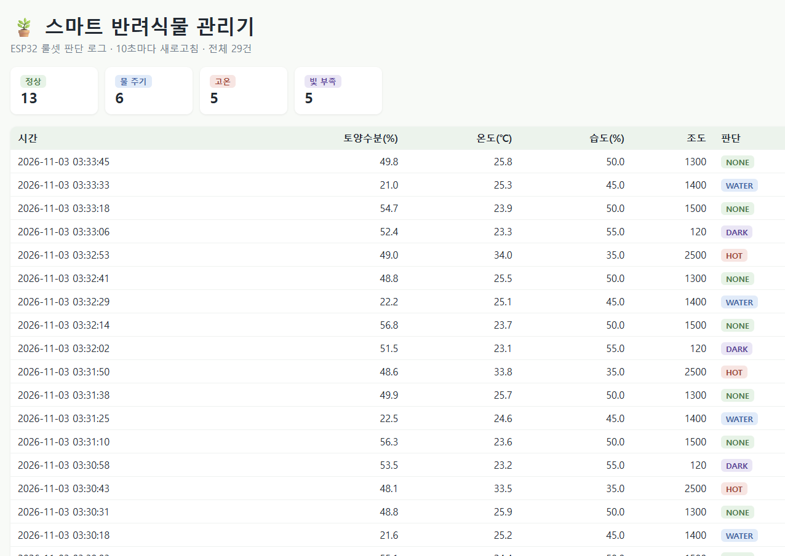

# 스마트 반려식물 관리기


Seeed XIAO ESP32S3 Sense가 센서값을 읽고 **룰셋 모델**로 행동을 정한 뒤, 로그를 서버의 **SQLite DB**에 저장합니다. **GitHub Actions CI**가 룰 테스트, 펌웨어 빌드, 서버 테스트를 자동으로 실행합니다.

```
[ESP32 + 센서] --(WiFi, HTTP POST JSON)--> [Flask 서버] --> [SQLite DB]
     └ 룰셋 모델 (rules.h)
GitHub Actions CI: 룰 단위테스트 + ESP32 빌드 + 서버 테스트
```

## 과제 조건
| 조건 | 구현 |
|---|---|
| 1. ESP32에 모델 넣기 | [firmware/include/rules.h](firmware/include/rules.h) 룰셋 모델 |
| 2. 로그를 DB에 저장 | [server/app.py](server/app.py) Flask + SQLite |
| 3. CI 구현 | [.github/workflows/ci.yml](.github/workflows/ci.yml) |

## 진행 과정
1. **설계:** 룰셋 모델을 하드웨어와 분리된 순수 함수(`decide()`)로 만들었습니다. 그래서 ESP32 없이 PC와 CI에서도 단위테스트를 할 수 있습니다.
2. **저장소와 CI 먼저 구성:** GitHub 저장소를 만들고 CI 파일을 먼저 올렸습니다. 이후 모든 커밋이 자동으로 검증되도록 했습니다.
3. **서버(DB) 구현:** Flask와 SQLite로 `POST /logs`(저장)와 `GET /logs`(조회)를 만들었습니다. 필수 필드가 빠진 요청은 400으로 거절합니다.
4. **보드 변경 대응:** 처음에는 ESP32 DevKit을 기준으로 작성했다가, 실제 보드인 XIAO ESP32S3 Sense에 맞게 보드 설정과 핀(A0/A1/D3/D4)을 바꿨습니다.
5. **보드 연결과 업로드:** XIAO에 U.FL 안테나를 연결하고 펌웨어를 업로드했습니다. WiFi 연결을 확인했습니다.
6. **센서가 없는 상황 대응:** 외부 센서가 없어 DHT 값을 읽지 못했습니다. 그래서 시나리오 값을 생성하는 시뮬레이션 모드를 추가해, 룰 판단 → DB 저장 흐름을 실제 보드에서 검증했습니다.
7. **대시보드 추가:** 저장된 로그를 한눈에 보도록 `/` 경로에 판단별 개수와 로그 표를 보여주는 페이지를 만들었습니다.
8. **그래프 추가:** 토양수분과 온도의 변화를 선 그래프로 보여주고, 룰 기준선(30%, 32℃)을 점선으로 표시했습니다. 마우스를 올리면 그 시점의 값과 판단이 나옵니다. 단위가 달라 두 값을 그래프 하나에 겹치지 않고 나눴습니다.

## 검증 결과
**ESP32 시리얼 출력:** 보드가 판단한 결과를 서버로 보내고, 서버가 `201`(저장 성공)을 응답합니다.
```
WiFi OK: 192.168.45.240
Simulated sensor mode
{"soil":56.8,"temp":24.5,"hum":50.0,"light":1500,"action":"NONE"} -> 201
{"soil":21.3,"temp":24.5,"hum":45.0,"light":1400,"action":"WATER"} -> 201
{"soil":47.9,"temp":25.9,"hum":50.0,"light":1300,"action":"NONE"} -> 201
```

**DB에 저장된 로그 (대시보드):** 네 가지 판단이 모두 기록됐습니다.



| 시간 | 토양수분(%) | 온도(℃) | 습도(%) | 조도 | 판단 |
|---|---|---|---|---|---|
| 2026-11-03 03:32:29 | 22.2 | 25.1 | 45.0 | 1400 | WATER |
| 2026-11-03 03:32:14 | 56.8 | 23.7 | 50.0 | 1500 | NONE |
| 2026-11-03 03:32:02 | 51.5 | 23.1 | 55.0 | 120 | DARK |
| 2026-11-03 03:31:50 | 48.6 | 33.8 | 35.0 | 2500 | HOT |

**CI (GitHub Actions):** 푸시할 때마다 아래 항목을 자동으로 실행하고 모두 통과했습니다. 결과는 [Actions 탭](https://github.com/maraoj1004-collab/smart-plant/actions)에서 볼 수 있습니다.
- `firmware` 작업: 룰 단위테스트 7개 (`pio test -e native`), XIAO ESP32S3 펌웨어 빌드
- `server` 작업: 서버 테스트 4개 (저장/조회, 최신순 정렬, 잘못된 요청 거절, 대시보드)

## 문제 해결 기록
| 문제 | 원인 | 해결 |
|---|---|---|
| PC가 보드를 인식하지 못함 | 데이터 연결이 안 됨 | 케이블과 연결을 다시 해서 COM3으로 인식 |
| `DHT read failed` 반복 | 외부 센서가 연결되지 않음 | 시뮬레이션 모드 추가 |
| `localhost:5000`에서 Not Found | 서버에 `/` 경로가 없었음 | 대시보드 페이지 추가 |

## 시뮬레이션 모드
센서 없이 시연할 수 있도록 `USE_SIMULATED_SENSORS 1`(기본값)일 때 정상 → 건조 → 정상 → 고온 → 어두움 시나리오 값을 차례로 생성합니다. 룰 판단과 DB 저장은 실제와 똑같이 동작하고, `WATER`일 때 펌프 대신 보드 LED가 3초 켜집니다. 실제 센서를 연결하면 [main.cpp](firmware/src/main.cpp)에서 값을 `0`으로 바꾸면 됩니다.

## 룰셋 모델
위에서부터 먼저 맞는 룰 하나를 적용합니다.

| 우선순위 | 조건 | 행동 |
|---|---|---|
| 1 | 토양수분 < 30% | `WATER` 펌프 3초 작동 |
| 2 | 온도 > 32℃ | `HOT` 고온 경고 |
| 3 | 조도 < 200 | `DARK` 빛 부족 경고 |
| - | 그 외 | `NONE` |

## 배선
| 부품 | XIAO 핀 |
|---|---|
| 토양수분 센서 (AO) | A0 (D0) |
| 조도 센서 LDR (분압) | A1 (D1) |
| DHT22 (DATA) | D3 |
| 릴레이 (IN) → 펌프 | D4 |

- 센서 전원은 3V3과 GND에 연결합니다. XIAO의 GPIO는 3.3V라 5V 신호를 직접 넣으면 안 됩니다.
- 5V 릴레이 모듈은 VCC를 5V(VBUS) 핀에 연결합니다.
- WiFi를 쓰려면 함께 들어 있는 U.FL 안테나를 꼭 연결해야 합니다.

## 실행 방법
### 서버
```bash
cd server
pip install -r requirements.txt
python app.py          # 대시보드 http://localhost:5000
python -m pytest       # 테스트
```
Windows 방화벽에서 5000번 포트를 허용하세요.

### 펌웨어 (VS Code + PlatformIO)
1. `firmware/include/secrets.example.h`를 `secrets.h`로 복사하고 WiFi와 서버 주소를 채웁니다.
2. `pio run -e xiao_esp32s3 -t upload`로 업로드하고 `pio device monitor`로 확인합니다.
3. `pio test -e native`로 룰 테스트를 PC에서 실행합니다.

## API
- `POST /logs` 요청 본문: `{"soil":20,"temp":25,"hum":50,"light":800,"action":"WATER"}`
- `GET /logs` 최근 50개 로그 (최신순, JSON)
- `GET /` 로그 대시보드: 판단별 개수, 토양수분/온도 그래프, 로그 표 (10초마다 새로고침)
